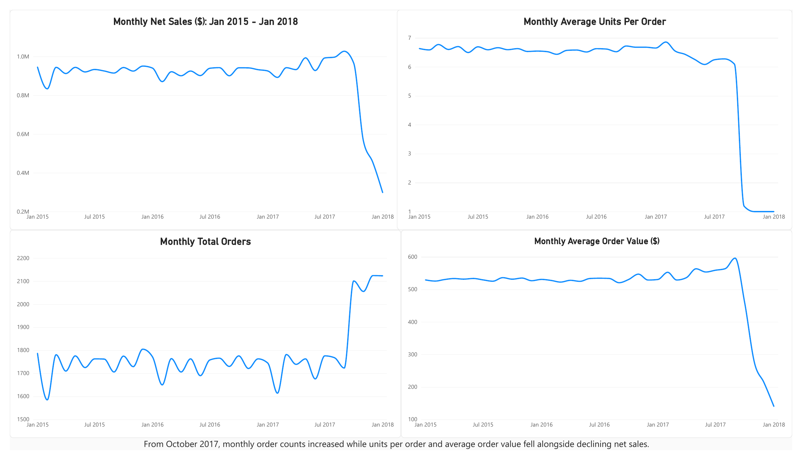
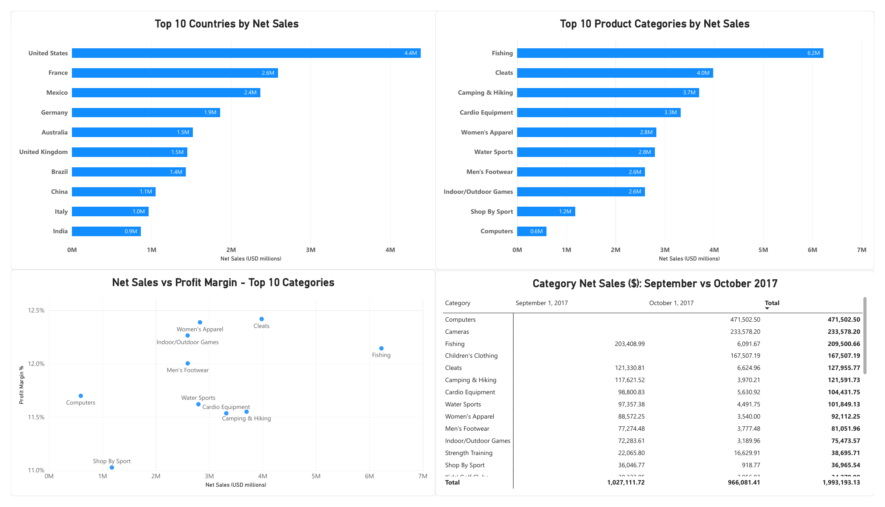
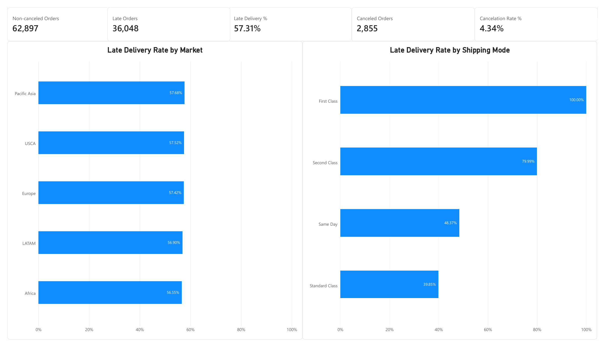
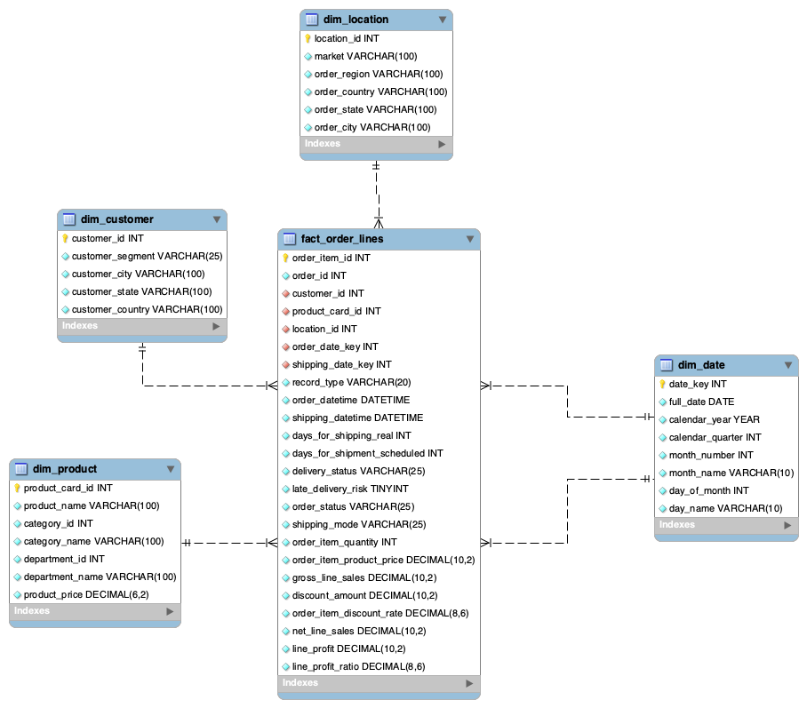

# DataCo Supply Chain Analytics

An analytics project using Excel, Power Query, MySQL, and Power BI to examine sales, profitability, order composition, and delivery performance.

The analysis covers January 2015 through January 2018 and connects SQL findings with an interactive Power BI report.

[View the dashboard PDF](power-bi/dataco_dashboard.pdf) · [Download the Power BI report](power-bi/dataco_supply_chain_dashboard.pbix)

## Business Questions

- How did monthly sales and order volume change?
- Which countries and product categories generated the most net sales?
- Did higher sales correspond to higher profit margins?
- How did order composition change during the revenue decline?
- How did late delivery rates differ by market and shipping mode?

## Tools and Workflow

1. **Excel and Power Query:** inspected the source data, standardized column names and data types, and checked sales calculations.
2. **MySQL:** created staging tables and a star schema, validated relationships, and analyzed business performance.
3. **Power BI and DAX:** built reusable measures, validated results against SQL, and created interactive report pages.
4. **Git and GitHub:** maintained SQL scripts, model documentation, and report deliverables.

SQL techniques include joins, aggregations, subqueries, CTEs, `LAG()`, `RANK()`, and `CASE`.

## Overall Results

| Metric | Result |
| --- | ---: |
| Unique orders | 65,752 |
| Order lines | 180,519 |
| Units sold | 384,079 |
| Net sales | $33,054,402.04 |
| Total profit | $3,966,902.97 |
| Profit margin | 12.00% |
| Average order value | $502.71 |
| Average units per order | 5.84 |
| Late delivery rate, excluding canceled orders | 57.31% |
| Cancellation rate | 4.34% |

## Key Findings

### Revenue declined while order counts increased

Monthly net sales peaked at approximately $1.03 million in September 2017.

From September to October 2017, orders increased from 1,723 to 2,101, but units sold fell from 10,502 to 2,490. Average units per order decreased from 6.10 to 1.19.

This shows that higher order volume did not translate into higher revenue: orders contained fewer units, and average order value declined.

### The recorded category mix changed substantially

Fishing generated $203,408.99 in September 2017 but only $6,091.67 in October. Computers had no recorded September sales and generated $471,502.50 in October.

Computer sales partly offset declining sporting-goods sales. The data shows a change in category composition, but does not establish why it happened.

### Shipping modes showed larger differences than markets

Late delivery rates ranged from 56.55% to 57.68% across markets—a difference of 1.13 percentage points.

Shipping-mode rates ranged from 39.85% for Standard Class to 100% for First Class. All 9,602 included First Class orders were flagged as late in the dataset.

These results identify an area for investigation; they do not establish that shipping mode caused the delays.

## Dashboard Previews

### Overview

Monthly net sales, order volume, average units per order, and average order value.

### Sales and Profitability

Top countries and categories, category profit margins, and the September–October 2017 category comparison.

### Delivery Performance

Order counts, cancellation rate, and late delivery rates by market and shipping mode.

The report also includes a Validation page for checking headline measures against SQL results.

## Data Model

The star schema contains:

- `fact_order_lines`: one row per order item, identified by `order_item_id`.
- `dim_customer`: customer attributes and segments.
- `dim_product`: product, category, and department attributes.
- `dim_location`: geographic attributes, including standardized English country names.
- `dim_date`: calendar attributes used for time analysis.

Dimensions filter the fact table through one-to-many relationships. The order-date relationship is active; the shipping-date relationship is inactive.

## Viewing the Report

- Open the PDF to view a static version without Power BI.
- Download the `.pbix` file and open it in Power BI Desktop on Windows to explore the report.
- Select bars or data points to see related visuals respond.
- Refreshing the report requires the exported CSV tables and updated local source paths.

## Repository Contents

| Folder | Contents |
| --- | --- |
| `sql/` | Schema, loading, validation, and analysis scripts |
| `documentation/` | Star schema diagram |
| `power-bi/` | Power BI report and dashboard PDF |
| `images/` | Dashboard preview images |

Raw data, exported CSV tables, and large working Excel files are excluded from version control.

## Data Source and Limitations

Source: [DataCo Smart Supply Chain dataset](https://data.mendeley.com/datasets/8gx2fvg2k6/3).

- Findings describe the supplied dataset and should not be treated as verified operational results for a current business.
- Late delivery calculations use the dataset's `late_delivery_risk` flag and exclude orders marked `Shipping canceled`.
- First and last category dates indicate observed orders, not confirmed product launch or discontinuation dates.
- Changes in product mix and revenue are observed associations; their underlying causes are unknown.
- The dataset does not support inventory stock accuracy or employee productivity analysis.
